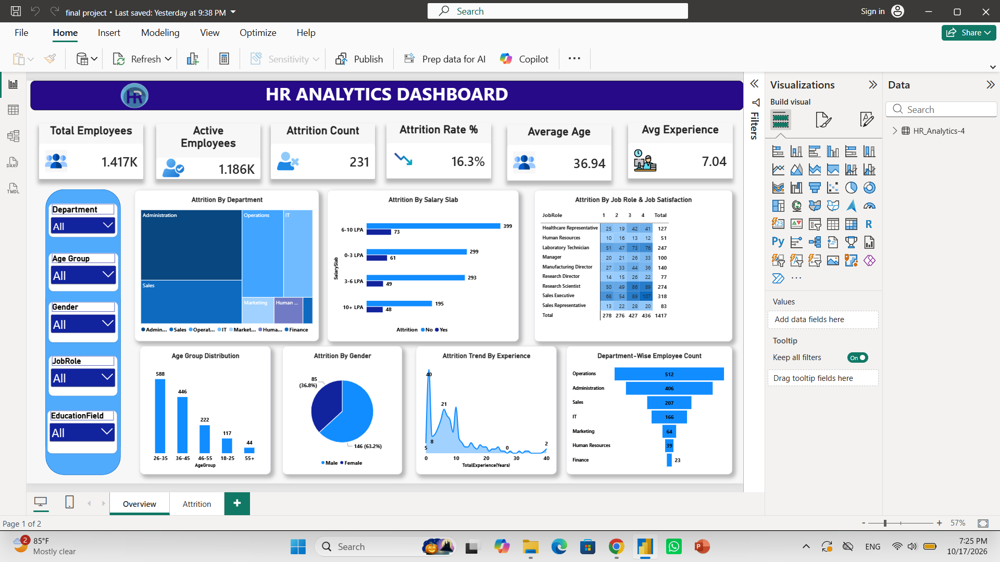
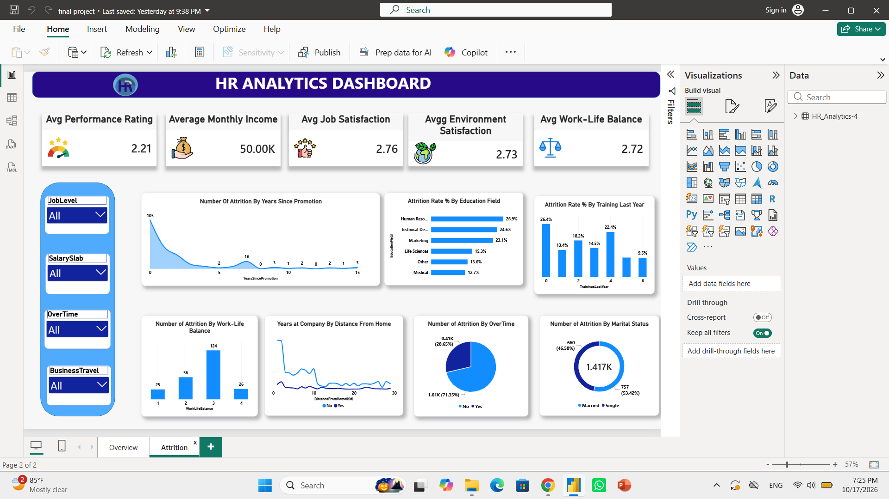

# 📊 HR Analytics Dashboard | Power BI

An interactive, 2-page Power BI dashboard that analyzes employee attrition and helps answer one question: **why do employees leave?**

## 🎯 Project Overview
This project explores a dataset of **1,417 employees** across 7 departments to uncover the factors behind employee turnover, so HR teams can make data-driven retention decisions.

## 📌 Key Figures
| Metric | Value |
|---|---|
| Total Employees | 1,417 |
| Active Employees | 1,186 |
| Attrition Count | 231 |
| Attrition Rate | 16.3% |
| Average Age | 36.94 years |
| Average Experience | 7.04 years |

## 📄 Dashboard Pages

### Page 1: Overview
- KPIs: total employees, active employees, attrition count and attrition rate
- Attrition by department, salary slab, gender and age group
- Attrition by job role and job satisfaction
- Attrition trend by years of experience
- Slicers: department, age group, gender, job role and education field

### Page 2: Attrition Deep Dive
- Impact of overtime on attrition
- Work-life balance, years since promotion and training last year
- Attrition by marital status, education field and distance from home
- Average performance rating, monthly income, job satisfaction and environment satisfaction

## 🛠️ Tools Used
- **Power BI Desktop**
- **DAX**

## 📂 Files
- `final project.pbix`: the Power BI report file
- `overview.png`, `attrition.png`: dashboard screenshots

## 👩‍💻 Author
**Yasmeen Abdelkader**, Data Analyst
